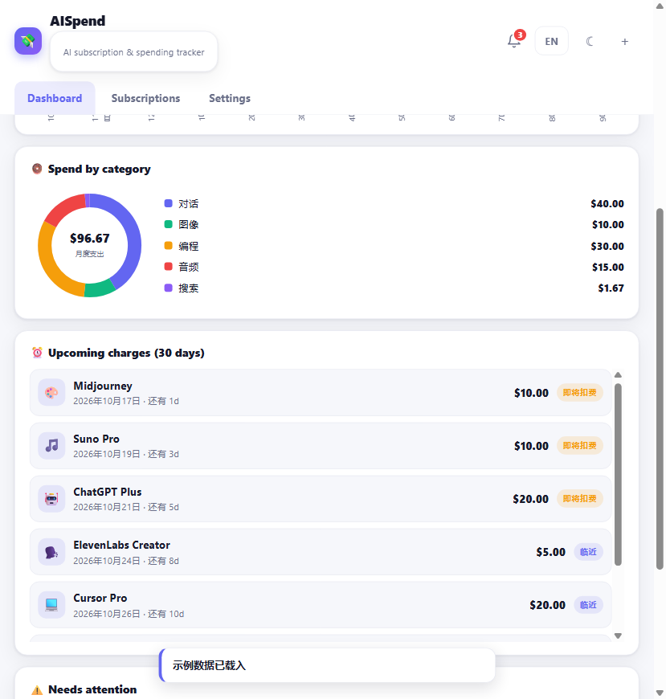
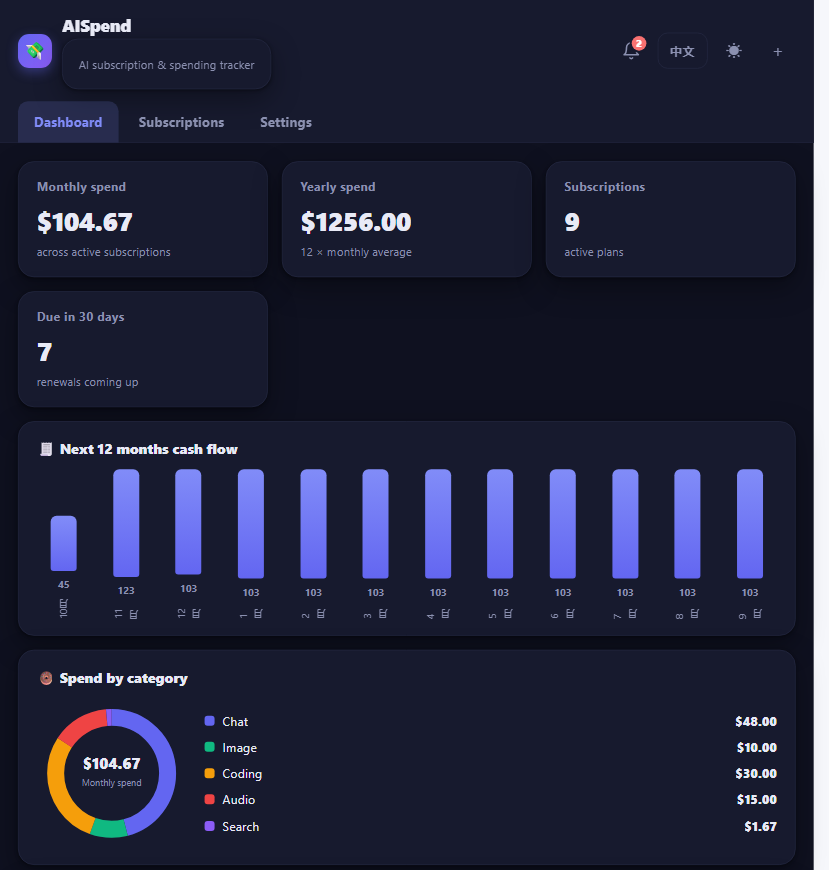
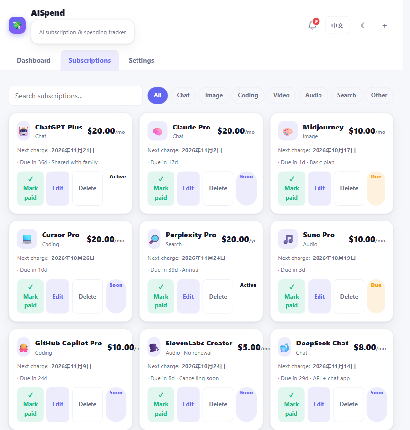
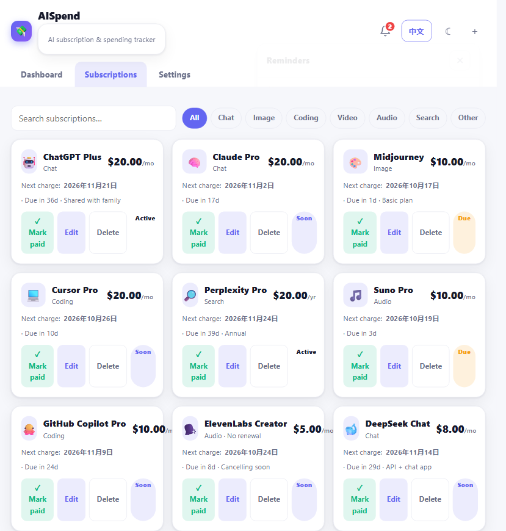
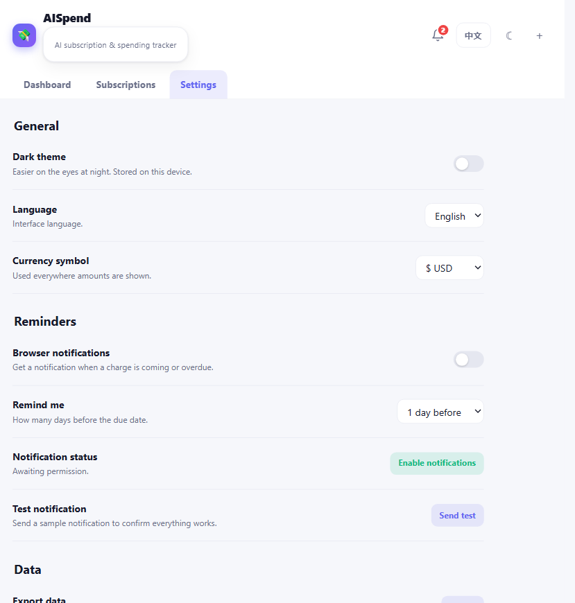

# 💸 AISpend — AI Subscription & Spending Tracker

**Know exactly how much your AI subscriptions cost — every month, every year, all in one offline page.**

Track ChatGPT Plus, Claude, Midjourney, Cursor, Perplexity and every other AI service you pay for. AISpend tells you what your AI stack is really costing you, when the next charge hits, and where your money goes by category. **No install, no accounts, no servers, no tracking — 100% local & offline.**

> In 2026 the community's biggest worry about AI is no longer "can it code" — it's "how do I keep the subscriptions from burning through my wallet." AISpend is the zero-setup answer: open one file, add your plans, see the truth.

## ✨ Features

| | |
|---|---|
| 📊 **Dashboard** | monthly & yearly spend, subscription count, charges due in 30 days |
| 🧾 **12-month cash-flow forecast** | see exactly which months will hit your wallet hardest |
| 🍩 **Category breakdown** | live donut chart by Chat / Image / Coding / Video / Audio / Search / Other |
| ➕ **AI service library** | one-click add of 16 popular plans (ChatGPT Plus, Claude Pro, Midjourney, Cursor Pro, Perplexity Pro, Suno, ElevenLabs, …) — reference prices, fully editable |
| ⏰ **Upcoming charges & attention list** | every renewal in the next 30 days, plus anything overdue or within 7 days |
| 💳 **Mark paid** | roll the next charge forward automatically when you pay |
| 🔔 **Browser notifications** | optional OS-level alerts with configurable lead time (same day / 1 / 3 / 7 days) |
| 🔔 **In-app reminder center** | header bell with live badge — works fully offline, no system permission needed |
| 🌐 **English & 中文** | one-click language switch |
| 🌙 **Light / dark theme** | easy on the eyes at night |
| 🔐 **Private by design** | everything lives in your browser's localStorage; zero network requests |
| 💾 **Export / Import** | full JSON backup and restore |

## 📸 Screenshots

| Dashboard (light) | Dashboard (dark) |
|---|---|
|  |  |

| Subscriptions | Reminder center |
|---|---|
|  |  |

| Settings | 中文界面 |
|---|---|
|  |  |

## 🚀 Quick start

**Option A — just use it:** download [`index.html`](index.html) and open it in any modern browser (Chrome, Edge, Firefox, Safari). That's it.

**Option B — for browser notifications:** open it over a secure context:

```bash
# serve the folder over localhost (needs Python)
python -m http.server 8138
# then open http://localhost:8138
```

> 🔔 Reminders: browser notifications require a secure context (`http://localhost` or https). On `file://` they are unavailable — the app tells you why, and the **in-app reminder center still works** everywhere.

## 💡 How it works

- Add a subscription with its price, billing cycle (monthly / yearly) and next charge date — or pick one from the built-in AI service library.
- The dashboard instantly recomputes **monthly spend** (yearly plans are prorated), **yearly spend**, the **12-month cash-flow forecast** and the **category donut**.
- Hit **Mark paid** after a renewal: the next charge date rolls forward by one cycle automatically.
- The header bell shows how many charges need attention; the panel groups overdue and upcoming charges.
- Everything is stored in `localStorage` under the key `aispend.v1`.

## 🔐 Privacy

- All data stays in your browser's `localStorage` on **your** device.
- The app makes **zero network requests** — it works fully offline.
- Browser notifications (if enabled) are generated locally by your browser and never leave your device.
- No analytics, no cookies, no accounts, no servers.

## 🛠 Tech

- Single `index.html`, vanilla JavaScript, **zero dependencies** — no CDN, no framework, no build step.
- Charts are hand-rolled inline SVG (donut + bars), fully offline.
- EN / 中文 interface, light / dark theme, CSV-free JSON import/export.
- Works in any modern browser on desktop and mobile.

## 📄 License

MIT © 2026 Koiliblly — see [LICENSE](LICENSE).
